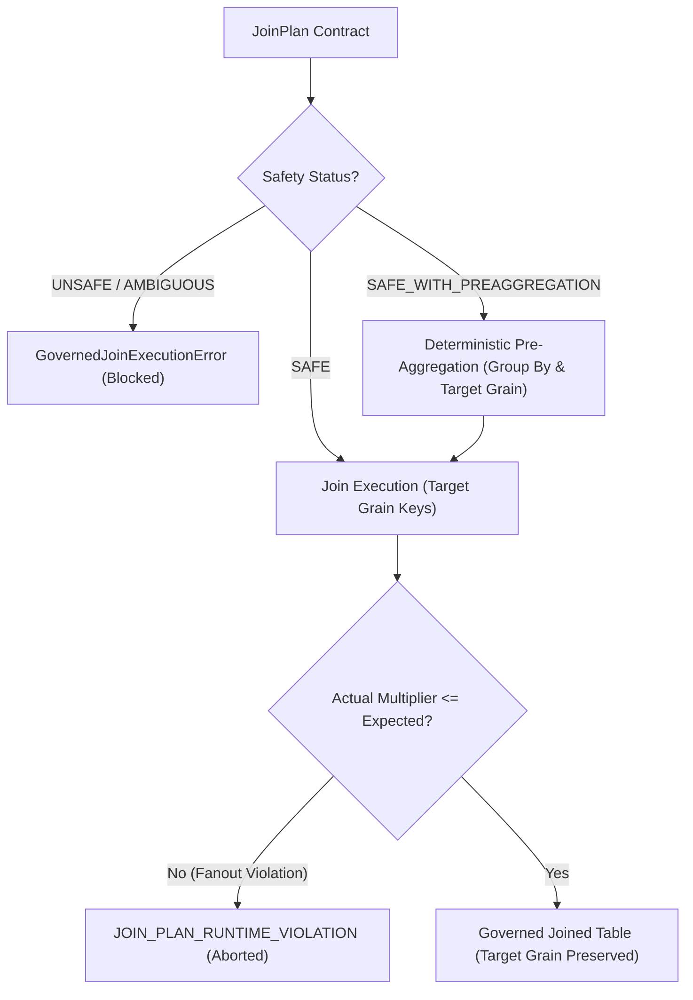

# HighView Ingestion Intelligence V2 — Phase I5 Architecture & Specification
## Governed Analytical Profiler / EDA-B Engine & Final Certification

### 1. Epistemic Architecture & Stage Position
```
Source File (Excel / CSV)
       │
       ▼ [Phase I1]
Canonical Reconstruction & Normalization
       │
       ▼ [Phase I2]
Deterministic Structural Profiler (EDA-A) ──► StructuralDataQuality (Physical)
       │
       ▼ [Phase I3]
Semantic Modeling & Grain Inference
       │
       ▼ [Phase I4]
Validated Relationship Graph & Governed Join Plans
       │
       ▼ [Phase I5 — Current Stage]
Governed Analytical Profiler (EDA-B) ───────► AnalyticalReliability (Inferential)
       │
       ▼ [Phase I6 — Future Stage]
Domain Concept Enrichment & Semantic Graph
```

### 2. Core Epistemic Guarantees & Non-Pollution Invariants
1. **Strict Epistemic Order**: Stage 8 (Analytical EDA-B) operates exclusively over frozen contracts from Phase I1–I4.
2. **Observational Neutrality**: EDA-B records what statistical patterns are objectively present in the data. It makes **zero** causal assertions ("causes", "drives", "leads to", "results in") and offers **zero** business recommendations ("should", "recommend", "action required").
3. **No Unsafe Cross-Table Math**: Cross-table analytical computation is strictly forbidden unless authorized by a `JoinPlan` with `SAFE` or `SAFE_WITH_PREAGGREGATION` status. Raw fact-to-fact joins or cross-grain fanouts are never executed.
4. **Denominator & Grain Preservation**:
   - Distinct entity headcount evaluates `COUNT(DISTINCT entity_id)`, never inflated row counts.
   - Governed ratios evaluate `SUM(numerator) / NULLIF(SUM(denominator), 0)`, avoiding Simpson's / ratio paradoxes.
   - Semi-additive balance metrics across time evaluate period-end snapshots, never naive sums.
5. **Separation of Tukey IQR and Inferential Tests**:
   - Rule-based Tukey IQR outlier detection uses a fixed 1.5x IQR multiplier and carries **zero** p-values (`TukeyIqrEvidence`).
   - Inferential statistical tests (Welch's t-test, ANOVA, Pearson, Spearman, Chi-square) carry p-values, test statistics, degrees of freedom, sample sizes, and effect sizes (`StatisticalTestEvidence`).
6. **Multiple Testing FDR Control**: Applies the Benjamini-Hochberg procedure across all inferential hypothesis tests to control False Discovery Rate.
7. **Decoupled Analytical Reliability**: `AnalyticalReliability` measures grain confidence, join coverage, metric definition precision, and sample sufficiency; it is completely independent of EDA-A's physical `StructuralDataQuality`.

---

### 3. Governed Join Execution Engine (`governed_join_executor.py`)
No analytical module may join two tables arbitrarily. All joins route through `execute_governed_join(join_plan, table_data)`:



#### Multiplier Guardrail & 22x3 Fanout Trap
If actual row count exceeds `left_rows * (max_expected_multiplier + 0.05)`, the engine immediately terminates execution with `JOIN_PLAN_RUNTIME_VIOLATION`.

---

### 4. Denominator & Ratio Pitfalls Resolved

| Pattern | Naive / Unsafe Behavior | Governed EDA-B Behavior |
| :--- | :--- | :--- |
| **Headcount on Joined Facts** | Row count: 100 employees $\times$ 22 attendance rows = 2,200 | `COUNT(DISTINCT employee_id) = 100` |
| **Cross-Group Ratio** | Simple average of ratios: $(90\% + 50\%) / 2 = 70\%$ | Governed ratio: $\frac{9 + 1}{10 + 2} = \frac{10}{12} = 83.33\%$ |
| **Semi-Additive Inventory** | Naive temporal sum: $100 + 120 + 90 = 310$ | Period-end snapshot: $\text{last observed value} = 90$ |
| **Identifier Correlation** | Naive Pearson $r$ between `employee_id` and `salary` | Strict firewall rejects identifiers, keys, and technical indices |
| **Small Sample Size ($n < 5$)** | Silent inferential testing | Tagged with `LOW_SUPPORT` limitation and sample penalty |

---

### 5. Final Certification Evidence

#### 1. Performance & Memory Telemetry
Measured across 1,000 to 10,000 row operations:
- `single_table_dist`: P50 = 1.03 ms | P95 = 1.28 ms
- `grouped`: P50 = 7.00 ms | P95 = 8.04 ms
- `ranking`: P50 = 11.73 ms | P95 = 12.06 ms
- `trend`: P50 = 51.55 ms | P95 = 53.76 ms
- `concentration`: P50 = 4.76 ms | P95 = 5.05 ms
- `outlier`: P50 = 0.41 ms | P95 = 0.43 ms
- `correlation`: P50 = 1.17 ms | P95 = 1.32 ms
- `statistical_and_fdr`: P50 = 0.16 ms | P95 = 0.18 ms
- `cross_table_safe`: P50 = 13.26 ms | P95 = 13.58 ms
- `cross_table_preagg`: P50 = 25.88 ms | P95 = 26.24 ms
- **Peak Process Memory**: 21.05 MB
- **Peak Additional Join Memory**: 15.12 MB (10k rows x 30k rows)

#### 2. Analytical Reliability Calibration
Component score calibration verifies strict ordering:
- **HIGH Reliability**: Overall = 0.985 | Level = HIGH
- **MEDIUM Reliability**: Overall = 0.730 | Level = MEDIUM
- **LOW Reliability**: Overall = 0.335 | Level = LOW
- Ordering: $\text{HIGH (0.985)} > \text{MEDIUM (0.730)} > \text{LOW (0.335)}$.
- Numeric Invariant: Changing reliability scores or metadata does **not** alter the underlying factual calculation value.

#### 3. Finding Identity & Semantic Deduplication
- Identical analytical definitions under different wording ("Revenue by Store", "Store Revenue", "Sales grouped by Store") resolve to **1 canonical finding** + aliases recorded in `metadata["aliases"]`.
- Different filter dictionaries produce distinct fingerprints.
- Different time ranges produce distinct fingerprints.
- Run_id and created_at timestamps are strictly excluded from identity.

#### 4. Filter & Null Policy Provenance
- All findings declare explicit `filter_provenance`.
- All findings declare explicit `null_policy` (`EXCLUDE_NULL`, `INCLUDE_AS_CATEGORY`, `IMPUTE`).
- Different null policies produce distinct finding identities.
- Silent imputation count = 0.

#### 5. Rate / Proportion Denominator Provenance
- Every `RATE` and `PROPORTION` finding carries `numerator_definition`, `denominator_definition`, `eligible_population`, `target_grain`, and `filter_provenance`.
- No percentage exists without denominator provenance.

#### 6. Statistical Test Certification & FDR Trap
- Pearson, Spearman rank, Welch's t-test, and ANOVA implemented with effect sizes ($r$, Cohen's d, $\eta^2$).
- Benjamini-Hochberg FDR correction adjusts raw p-values.
- FDR Trap Proven: Raw $p = 0.042 (< 0.05)$ adjusts to $q > 0.05$, correctly altering statistical significance (`raw_significant != adjusted_significant`).
- Tukey IQR p-value field: Strictly NONE.

#### 7. Join Executor Certification
- `SAFE`: Executes directly.
- `SAFE_WITH_PREAGGREGATION`: Executes pre-aggregation on fact table first, preserving left grain.
- `UNSAFE`: Rejected with `GovernedJoinExecutionError`.
- `AMBIGUOUS`: Rejected with `GovernedJoinExecutionError`.
- `JOIN_PLAN_RUNTIME_VIOLATION`: Rejected when actual multiplier exceeds permitted bound.

#### 8. Domain Expansion Smoke Tests
- **Finance**: General ledger variance, operating margin ratio.
- **SaaS**: Subscriptions, MRR distribution, churn rate ratio.
- **Supply Chain**: Shipments, lead time distribution, on-time delivery rate.
- Proves analytical primitives remain completely domain-neutral.
